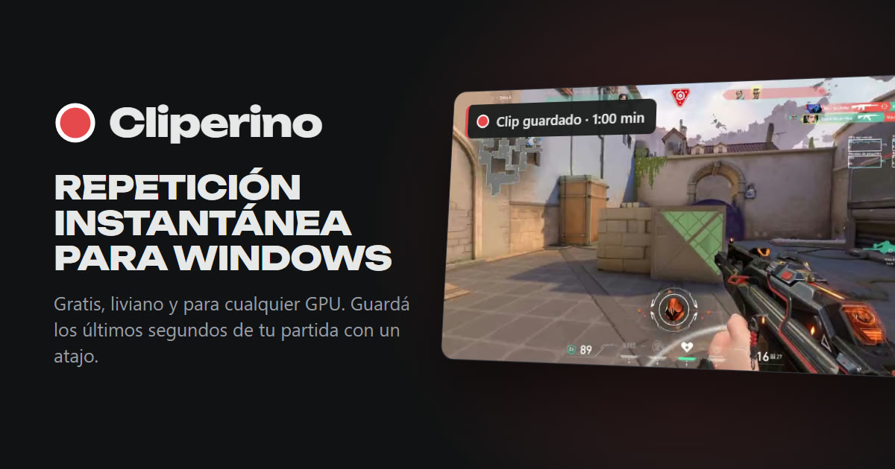
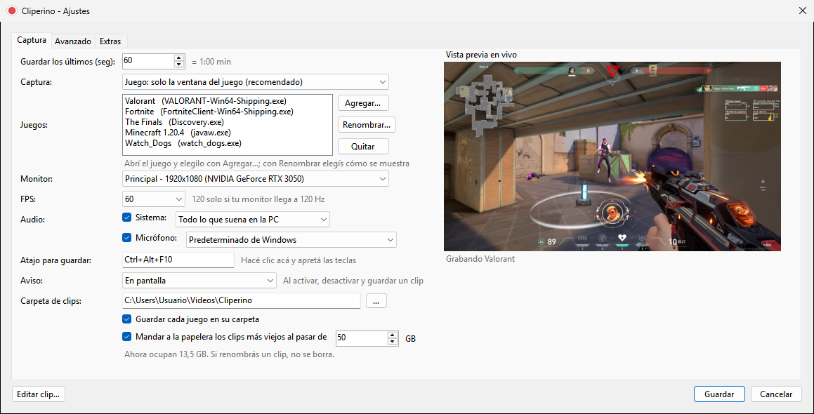
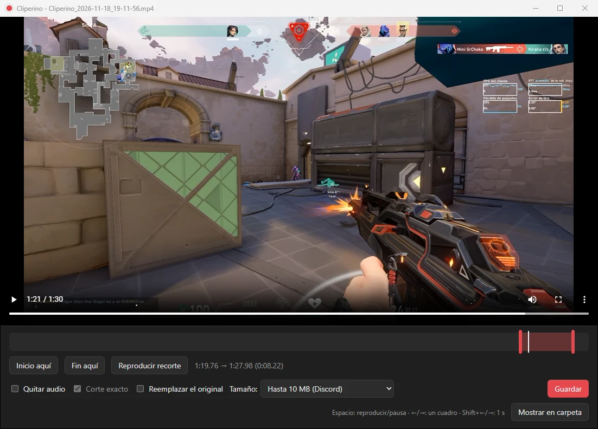

<p align="center">
  
</p>

<h1 align="center">Cliperino</h1>

<p align="center">
  Repetición instantánea gratis para Windows. Graba en segundo plano y, cuando pasa algo bueno, apretás una tecla y te guarda los últimos segundos.
</p>

<p align="center">
  <a href="https://github.com/dou-tools/cliperino/releases/latest"></a>
  <a href="https://github.com/dou-tools/cliperino/releases"></a>
  
  <a href="LICENSE"></a>
</p>

<p align="center">
  <a href="https://github.com/dou-tools/cliperino/releases/latest/download/Cliperino-Setup.exe"><b>Descargar el instalador</b></a> ·
  <a href="https://github.com/dou-tools/cliperino/releases/latest/download/Cliperino.exe">Versión portable</a> ·
  <a href="https://cliperino.lostdou.dev/">Sitio web</a> ·
  <a href="README.md">English</a>
</p>

<p align="center">
  
</p>

## Qué hace
- **Guarda lo que ya pasó:** tiene listos de 5 segundos a 20 minutos (de fábrica, 1 minuto) y los guarda con **Ctrl+Alt+F10**.
- **Cualquier GPU, o incluso sin una:** usa el codificador de NVIDIA, AMD o Intel, dedicada o integrada. Si no hay, usa el procesador.
- **Solo el juego:** graba la ventana del juego o la pantalla entera, y el audio de toda la PC o solo el del juego.
- **Tu voz, en su propia pista:** con el micrófono activado, los clips traen la mezcla y además el sistema y el micrófono por separado.
- **Editor incluido:** recortá el clip, sacale tu voz o todo el audio, y cortá en el cuadro exacto.
- **Listo para Discord:** comprime el clip para que entre en 10 MB (sin Nitro) o 50 MB (Nitro Basic).
- **Ordenado:** una carpeta por juego y un límite de espacio opcional que manda los clips más viejos a la papelera.
- **Privado:** sin cuenta, sin publicidad y sin nube. Solo se conecta para buscar actualizaciones y bajar ffmpeg, y verifica todo lo que descarga.

## Cómo se usa
1. Descargá e instalá Cliperino. La primera vez te ofrece bajar ffmpeg (unos 100 MB), que es lo que usa para grabar.
2. Abrí tu juego. Cliperino queda en la bandeja del sistema, al lado del reloj, grabando.
3. Cuando pase algo bueno, apretá **Ctrl+Alt+F10**. El clip queda en `Videos\Cliperino`. Hacé clic en el aviso para recortarlo o dejarlo listo para Discord.

Más respuestas en las [preguntas frecuentes de la web](https://cliperino.lostdou.dev/#faq).

<details>
<summary><b>Bandeja y Ajustes</b></summary>

- El ícono de la bandeja cambia de color según el estado: 🔴 grabando, ⚪ desactivado, 🟠 detectando o guardando.
- **Ctrl+Alt+F10** guarda los últimos N segundos en `Videos\Cliperino`, en una subcarpeta por juego (`Videos\Cliperino\VALORANT`, `Videos\Cliperino\cs2`…) si el juego está abierto. Cada juego puede tener un nombre propio (por ejemplo `THE FINALS` en vez de `Discovery.exe`), que se usa en la carpeta, en la bandeja y en el aviso. Al hacer clic en la notificación se abre el editor para recortarlo.
- Desde el menú de la bandeja se activa o desactiva la repetición, se guarda un clip, se edita un clip, se abre la carpeta y se entra a los **Ajustes**.
- **Ajustes** tiene tres pestañas:
  - **Captura:** vista previa en vivo de lo que se graba, duración, modo, juegos (con su nombre), monitor, FPS, audio, micrófono, atajo, aviso, carpeta, si cada juego va en su carpeta y un límite de espacio opcional: al pasarlo, los clips más viejos van a la papelera. Solo cuenta los archivos que nombró Cliperino (`Cliperino_*.mp4`), así que un clip que renombres nunca se borra.
  - **Avanzado:** codificador, formato (H.264 o HEVC), calidad y desfase de audio. La calidad puede ser Baja, Equilibrada o Alta, y el bitrate se calcula solo según el monitor, los FPS y el formato; con Personalizada se pone a mano. Si la placa no puede grabar en HEVC, Cliperino usa H.264 y avisa.
  - **Extras:** inicio con Windows, actualizaciones, idioma (español o inglés, por defecto el de Windows), versión y enlaces al proyecto. Cuando sale una versión nueva, Cliperino muestra sus novedades antes de actualizar: toma el texto de la release de GitHub y, si tiene secciones `EN:` y `ES:`, muestra la del idioma de la app.
- La vista previa de la pestaña Captura solo corre mientras esa pestaña está visible. Si cambiás el monitor, el modo o los juegos, muestra cómo va a quedar antes de guardar, sin cortar la grabación.



</details>

<details>
<summary><b>Editor de clips</b></summary>

Se abre haciendo clic en la notificación "Clip guardado" o con **Editar clip…**, en la bandeja o abajo a la izquierda de los Ajustes.

- **Recortar:** con las manijas de la línea de tiempo o con **Inicio aquí / Fin aquí** (teclas **I** / **O**). **P** reproduce solo el tramo elegido y las flechas avanzan cuadro por cuadro (**Shift** + flecha avanza 1 s).
- **Quitar micrófono:** deja el resto del sonido y saca tu voz. Solo aparece en los clips guardados con el micrófono activado.
- **Quitar audio:** deja el clip sin pista de audio.
- **Corte exacto:** recodifica el video con la GPU (o x264) para cortar en el cuadro elegido. Sin esta opción el corte es instantáneo pero cae en el keyframe anterior, hasta 1 s antes.
- **Tamaño:** comprime el recorte para que entre en 10 MB (Discord) o 50 MB (Discord Nitro Basic). Usa H.264 y baja la resolución y los FPS solo si hace falta, y lo guarda como `<clip>_10MB.mp4`.
- **Guardar:** por defecto crea `<clip>_editado.mp4` al lado del original; con **Reemplazar el original** lo sobrescribe.
- **Requisito:** usa Microsoft Edge WebView2, que ya viene instalado en Windows 10 y 11.



</details>

<details>
<summary><b>Audio</b></summary>

- **Sistema:**
  - *Todo el escritorio* (loopback del dispositivo predeterminado)
  - *Solo el juego*: captura por proceso; requiere Windows 11 y solo aplica en modo juego. Si no está disponible, usa el escritorio.
- **Micrófono:** opcional. El clip queda con tres pistas: primero la mezcla (la que usan los reproductores y Discord) y después el sistema y el micrófono por separado, para editarlos aparte en DaVinci Resolve o Premiere. Si tu editor reproduce las tres juntas, silenciá la primera.

</details>

## Compilar desde el código
Requisitos:
- Windows 10/11 x64
- [.NET 10 SDK](https://dotnet.microsoft.com/)
- ffmpeg 6 o superior. Si la app no lo encuentra, ofrece descargarlo (build *essentials* 9.0.2 de gyan.dev, verificada con su SHA-256) a `%LOCALAPPDATA%\Cliperino\ffmpeg`. También lo busca junto al `.exe` y en el `PATH`.

Ejecutar:
```
dotnet run
```

Publicar:
```
dotnet publish
```
Genera `publish\Cliperino.exe`: un único ejecutable de unos 50 MB que incluye el runtime de .NET, así que no hace falta instalar nada. Es lo único que hay que distribuir. La configuración está en `Cliperino.csproj`, en el bloque `Release`.

- **Versión liviana** (unos pocos MB, pero requiere el [.NET 10 Desktop Runtime](https://dotnet.microsoft.com/download/dotnet/10.0)):
  ```
  dotnet publish -p:SelfContained=false
  ```
- **ffmpeg** no va dentro del ejecutable: la app ofrece descargarlo la primera vez. Si preferís distribuirlo junto al `.exe`, la app lo encuentra igual, pero el build *essentials* es GPL y hay que incluir su licencia.
- **Versión de la Microsoft Store:** `.\store\build.ps1` arma `publish\store\Cliperino-<versión>.msix`. Esa versión trae ffmpeg con su licencia, no se actualiza sola (lo hace la Store) y usa el inicio automático de Windows. Necesita el [Windows SDK](https://developer.microsoft.com/windows/downloads/windows-sdk/). Con `-Install` además la instala para probarla, lo que requiere el modo de desarrollador.

<details>
<summary><b>Cómo funciona</b></summary>

- **Video:** ffmpeg graba segmentos MPEG-TS de 2 s en `%LOCALAPPDATA%\Cliperino\buffer`. Cliperino borra los que quedan fuera de la ventana de replay.
- **Audio:** el audio (del escritorio o del juego) y el micrófono opcional se guardan en buffers circulares en RAM, alineados con el reloj del sistema.
- **Sincronización:** al guardar, el audio se alinea con los timestamps (PTS) del video. Así sigue sincronizado aunque haya huecos, por ejemplo con el juego minimizado.
- **Guardado:** se concatenan los segmentos sin re-codificar, se codifica el audio a AAC (con micrófono, la mezcla y una pista aparte para cada fuente) y se escribe el `.mp4`.
- Los procesos ffmpeg están atados a un Job Object, así que si Cliperino se cierra o se cuelga, ffmpeg se cierra con él.

</details>

<details>
<summary><b>Estructura del proyecto</b></summary>

```text
cliperino/
├── Program.cs                   # Arranque, instancia única y modo --probe
├── Cliperino.csproj             # Proyecto .NET 10 y configuración de publicación
├── Cliperino.ico                # Ícono de la app
├── Core/                        # Base compartida
├── Ffmpeg/                      # Manejo de ffmpeg
├── Capture/                     # Video
├── Audio/                       # Sonido
├── UI/                          # Interfaz
├── Update/                      # Actualizaciones
├── store/                       # Paquete de la Microsoft Store: manifiesto, íconos y script
├── web/                         # Sitio web (cliperino.lostdou.dev)
└── .github/                     # Deploy del sitio y el script que arma su versión en inglés
```

</details>

<details>
<summary><b>Limitaciones</b></summary>

- Un solo atajo global por combinación. Si la overlay de NVIDIA usa Alt+F10, Cliperino no puede usarlo. Si el atajo está ocupado, la app avisa.
- En modo pantalla, algunos juegos en pantalla completa pueden no verse (sale el escritorio) y el contenido con DRM puede salir en negro. Para juegos conviene el modo juego.
- En pantallas HDR los colores pueden verse lavados.
- Los clips en HEVC ocupan menos, pero no todas las apps los reproducen (por ejemplo, las Fotos de Windows sin la extensión HEVC, o algunos chats).
- A 120 fps la captura solo llega a 120 cuadros reales si el monitor es de 120 Hz o más; si no, repite cuadros.
- El aviso en pantalla no se ve sobre juegos en pantalla completa exclusiva; sí en ventana sin bordes o en ventana, que es como corren la mayoría de los juegos actuales. Nunca aparece en los clips.
- El inicio del clip tiene unos 2 s de precisión (se corta por segmentos sin re-codificar).
- Si el audio no queda sincronizado, se ajusta con "Desfase de audio" en Ajustes.
- Con el límite de espacio activado, si la papelera está desactivada en esa unidad, Windows borra los clips viejos directamente.

</details>

## Privacidad
Cliperino no tiene cuentas, publicidad, analíticas ni servidores propios. Tus clips, ajustes y registros quedan en tu PC. Solo se conecta para buscar actualizaciones en GitHub y bajar ffmpeg, y verifica el SHA-256 de ambos antes de usarlos. Los detalles están en la [política de privacidad](https://cliperino.lostdou.dev/privacidad.html).

## Licencia y créditos
Cliperino se publica con [licencia MIT](LICENSE).

- **ffmpeg** no viene incluido: la app descarga el build *essentials* de gyan.dev, que tiene su propia licencia (GPL).
- Usa **NAudio** y **Vortice**, cada una con su licencia, y **Microsoft Edge WebView2** para el editor.
- El sitio usa la tipografía **Unbounded** (SIL Open Font License) y logos de juegos que son marcas de sus dueños. Los créditos están en los [términos de uso](https://cliperino.lostdou.dev/terminos.html).

¿Encontraste un error o tenés una idea? Abrí un [issue](https://github.com/dou-tools/cliperino/issues).
