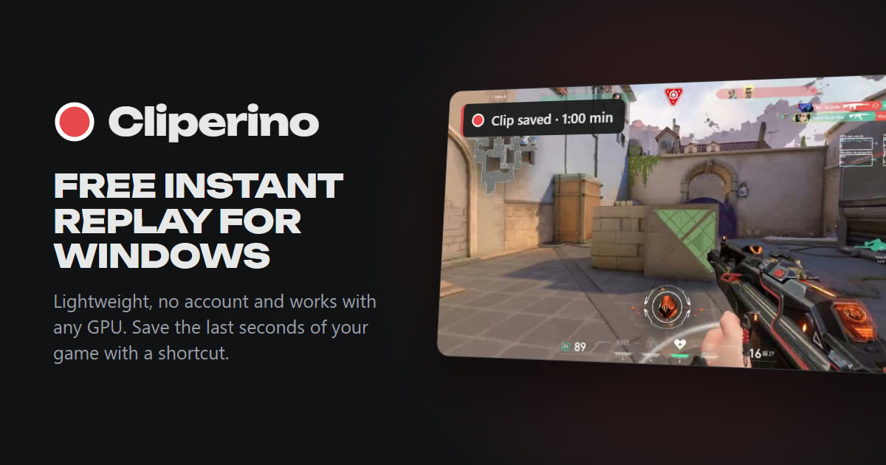
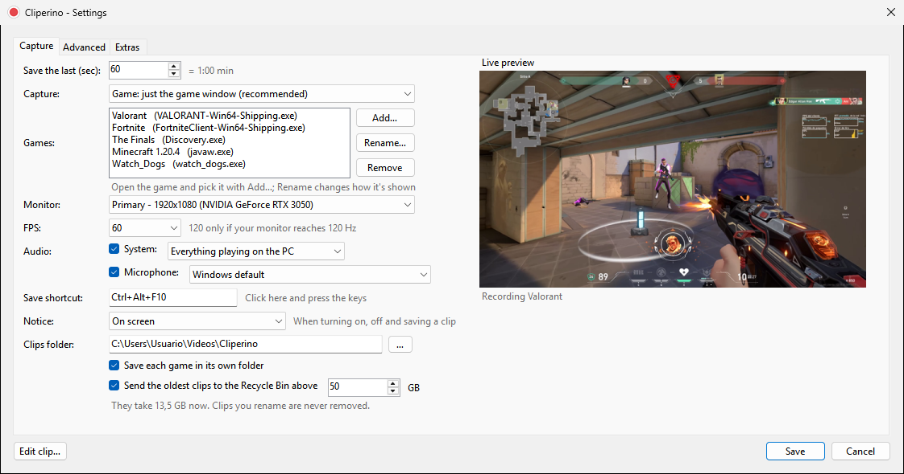
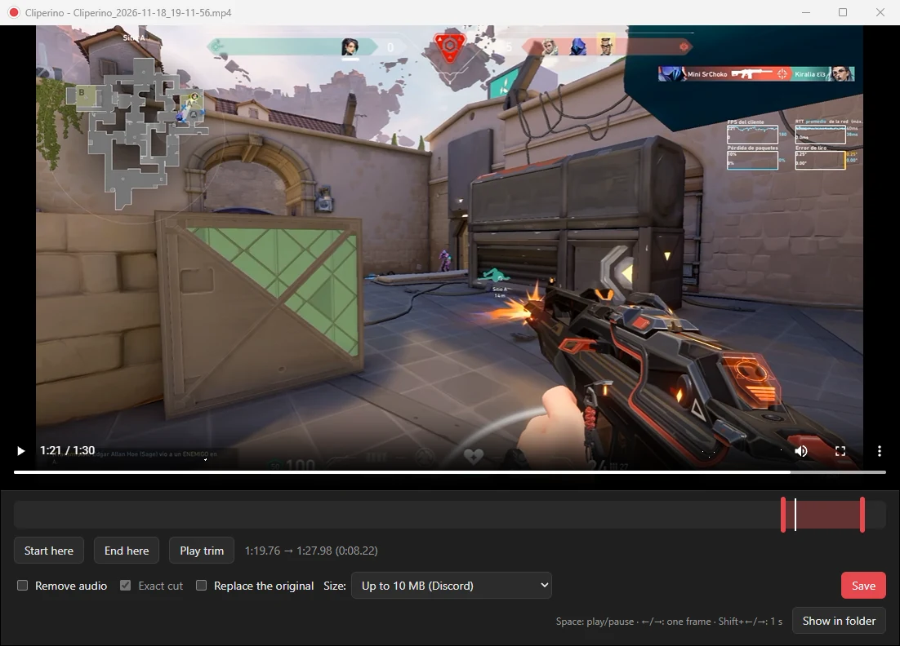

<p align="center">
  
</p>

<h1 align="center">Cliperino</h1>

<p align="center">
  Free instant replay for Windows. It records in the background and, when something good happens, you press a key and it saves the last few seconds.
</p>

<p align="center">
  <a href="https://github.com/dou-tools/cliperino/releases/latest"></a>
  <a href="https://github.com/dou-tools/cliperino/releases"></a>
  
  <a href="LICENSE"></a>
</p>

<p align="center">
  <a href="https://github.com/dou-tools/cliperino/releases/latest/download/Cliperino-Setup.exe"><b>Download the installer</b></a> ·
  <a href="https://github.com/dou-tools/cliperino/releases/latest/download/Cliperino.exe">Portable version</a> ·
  <a href="https://cliperino.lostdou.dev/en/">Website</a> ·
  <a href="README.es.md">Español</a>
</p>

<p align="center">
  
</p>

## Features
- **Saves what already happened:** keeps from 5 seconds to 20 minutes ready (1 minute by default) and saves them with **Ctrl+Alt+F10**.
- **Any GPU, or even none:** uses the NVIDIA, AMD or Intel encoder, dedicated or integrated. If there isn't one, it uses the processor.
- **Just the game:** records the game window or the whole screen, and the whole PC's audio or just the game's.
- **Your voice on its own track:** with the microphone on, clips have the mix plus the system and the microphone as separate tracks.
- **Built-in editor:** trim the clip, remove your voice or all the audio, and cut on the exact frame.
- **Ready for Discord:** compresses the clip to fit in 10 MB (no Nitro) or 50 MB (Nitro Basic).
- **Tidy:** one folder per game and an optional space limit that sends the oldest clips to the Recycle Bin.
- **Private:** no account, no ads, no cloud. It only goes online to check for updates and to download ffmpeg, and it verifies everything it downloads.

## How to use it
1. Download and install Cliperino. The first time, it offers to download ffmpeg (about 100 MB), which is what it uses to record.
2. Open your game. Cliperino sits in the system tray, next to the clock, recording.
3. When something good happens, press **Ctrl+Alt+F10**. The clip lands in `Videos\Cliperino`. Click the notice to trim it or get it ready for Discord.

More answers in the [FAQ on the website](https://cliperino.lostdou.dev/en/#faq).

<details>
<summary><b>Tray and Settings</b></summary>

- The tray icon changes color depending on the state: 🔴 recording, ⚪ off, 🟠 detecting or saving.
- **Ctrl+Alt+F10** saves the last N seconds to `Videos\Cliperino`, in a subfolder per game (`Videos\Cliperino\VALORANT`, `Videos\Cliperino\cs2`…) if the game is open. Each game can have its own name (for example `THE FINALS` instead of `Discovery.exe`), used for the folder, the tray and the notice. Clicking the notification opens the editor so you can trim it.
- From the tray menu you can turn instant replay on or off, save a clip, edit a clip, open the folder and open **Settings**.
- **Settings** has three tabs:
  - **Capture:** live preview of what's being recorded, duration, mode, games (with their names), monitor, FPS, audio, microphone, shortcut, notice, folder, whether each game gets its own folder and an optional space limit: above it, the oldest clips go to the Recycle Bin. It only counts the files Cliperino named (`Cliperino_*.mp4`), so a clip you rename is never removed.
  - **Advanced:** encoder, format (H.264 or HEVC), quality and audio offset. Quality can be Low, Balanced or High, and the bitrate is worked out from the monitor, FPS and format; with Custom you set it yourself. If the graphics card can't record HEVC, Cliperino uses H.264 and lets you know.
  - **Extras:** start with Windows, updates, language (Spanish or English, defaults to the Windows language), version and links to the project. When a new version is out, Cliperino shows what's new before updating: it takes the text of the GitHub release and, if it has `EN:` and `ES:` sections, shows the one in the app's language.
- The preview in the Capture tab only runs while that tab is visible. If you change the monitor, the mode or the games, it shows how it will look before you save, without stopping the recording.



</details>

<details>
<summary><b>Clip editor</b></summary>

Opens by clicking the "Clip saved" notification or with **Edit clip…**, in the tray or at the bottom left of Settings.

- **Trim:** with the timeline handles or with **Start here / End here** (keys **I** / **O**). **P** plays only the selected range and the arrow keys step frame by frame (**Shift** + arrow jumps 1 s).
- **Remove microphone:** keeps the rest of the sound and takes your voice out. Only shows up on clips saved with the microphone on.
- **Remove audio:** leaves the clip without an audio track.
- **Exact cut:** re-encodes the video with the GPU (or x264) to cut on the chosen frame. Without this option the cut is instant but lands on the previous keyframe, up to 1 s earlier.
- **Size:** compresses the trim to fit in 10 MB (Discord) or 50 MB (Discord Nitro Basic). It uses H.264 and lowers the resolution and FPS only when needed, and saves it as `<clip>_10MB.mp4`.
- **Save:** by default creates `<clip>_edited.mp4` next to the original; with **Replace the original** it overwrites it.
- **Requirement:** uses Microsoft Edge WebView2, which already comes installed on Windows 10 and 11.



</details>

<details>
<summary><b>Audio</b></summary>

- **System:**
  - *Everything playing on the PC* (loopback of the default device)
  - *Just the game*: per-process capture; requires Windows 11 and only applies in game mode. If it's not available, it falls back to the desktop.
- **Microphone:** optional. The clip keeps three tracks: the mix first (the one players and Discord use), then the system and the microphone on their own, to edit them separately in DaVinci Resolve or Premiere. If your editor plays all three at once, mute the first one.

</details>

## Build from source
Requirements:
- Windows 10/11 x64
- [.NET 10 SDK](https://dotnet.microsoft.com/)
- ffmpeg 6 or later. If the app can't find it, it offers to download it (gyan.dev *essentials* build 9.0.2, checked against its SHA-256) to `%LOCALAPPDATA%\Cliperino\ffmpeg`. It also looks for it next to the `.exe` and in the `PATH`.

Run it:
```
dotnet run
```

Publish it:
```
dotnet publish
```
Produces `publish\Cliperino.exe`: a single executable of about 50 MB that includes the .NET runtime, so nothing else needs to be installed. It's the only file you need to distribute. The settings live in `Cliperino.csproj`, in the `Release` block.

- **Lightweight version** (a few MB, but requires the [.NET 10 Desktop Runtime](https://dotnet.microsoft.com/download/dotnet/10.0)):
  ```
  dotnet publish -p:SelfContained=false
  ```
- **ffmpeg** isn't bundled in the executable: the app offers to download it the first time. If you'd rather ship it next to the `.exe`, the app will find it there too, but the *essentials* build is GPL and you have to include its license.
- **Microsoft Store version:** `.\store\build.ps1` builds `publish\store\Cliperino-<version>.msix`. That version includes ffmpeg and its license, doesn't update itself (the Store does) and uses Windows' own startup setting. It needs the [Windows SDK](https://developer.microsoft.com/windows/downloads/windows-sdk/). With `-Install` it also installs it so you can try it out, which requires Developer Mode.

<details>
<summary><b>How it works</b></summary>

- **Video:** ffmpeg records 2 s MPEG-TS segments to `%LOCALAPPDATA%\Cliperino\buffer`. Cliperino deletes the ones that fall outside the replay window.
- **Audio:** the audio (from the desktop or the game) and the optional microphone are kept in circular buffers in RAM, aligned with the system clock.
- **Sync:** when saving, the audio is aligned with the video timestamps (PTS). That way it stays in sync even when there are gaps, for example while the game is minimized.
- **Saving:** the segments are joined without re-encoding, the audio is encoded to AAC (with the microphone, the mix plus a separate track for each source) and the `.mp4` is written.
- The ffmpeg processes are tied to a Job Object, so if Cliperino closes or crashes, ffmpeg closes with it.

</details>

<details>
<summary><b>Project structure</b></summary>

```text
cliperino/
├── Program.cs                   # Startup, single instance and --probe mode
├── Cliperino.csproj             # .NET 10 project and publish settings
├── Cliperino.ico                # App icon
├── Core/                        # Shared base
├── Ffmpeg/                      # ffmpeg handling
├── Capture/                     # Video
├── Audio/                       # Sound
├── UI/                          # Interface
├── Update/                      # Updates
├── store/                       # Microsoft Store package: manifest, icons and build script
├── web/                         # Website (cliperino.lostdou.dev)
└── .github/                     # Website deploy and the script that builds its English version
```

</details>

<details>
<summary><b>Limitations</b></summary>

- Only one global shortcut per key combination. If the NVIDIA overlay uses Alt+F10, Cliperino can't use it. If the shortcut is already taken, the app lets you know.
- In screen mode, some fullscreen games may not show up (you get the desktop instead) and DRM-protected content may come out black. For games, game mode works better.
- On HDR displays colors may look washed out.
- HEVC clips are smaller, but not every app plays them (for example, Windows Photos without the HEVC extension, or some chat apps).
- At 120 fps, capture only gets 120 real frames if the monitor runs at 120 Hz or more; otherwise it repeats frames.
- The on-screen notice doesn't show over games in exclusive fullscreen; it does in borderless or windowed mode, which is how most modern games run. It never shows up in clips.
- The start of the clip is accurate to about 2 s (it's cut by segments without re-encoding).
- If the audio is out of sync, adjust it with "Audio offset" in Settings.
- With the space limit on, if the Recycle Bin is turned off for that drive, Windows deletes the old clips right away.

</details>

## Privacy
Cliperino has no accounts, ads, analytics or servers of its own. Your clips, settings and logs stay on your PC. It only goes online to check for updates on GitHub and to download ffmpeg, and it checks the SHA-256 of both before using them. The details are in the [privacy policy](https://cliperino.lostdou.dev/en/privacy.html).

## License and credits
Cliperino is released under the [MIT license](LICENSE).

- **ffmpeg** isn't included: the app downloads the gyan.dev *essentials* build, which has its own license (GPL).
- It uses **NAudio** and **Vortice**, each under its own license, and **Microsoft Edge WebView2** for the editor.
- The website uses the **Unbounded** typeface (SIL Open Font License) and game logos that are trademarks of their owners. The credits are in the [terms of use](https://cliperino.lostdou.dev/en/terms.html).

Found a bug or have an idea? Open an [issue](https://github.com/dou-tools/cliperino/issues).
